# Urban Cooling Planner: AI + GIS + Graph ML System
**Pilot City: Pune, India (Central Core AOI)**

An end-to-end urban climate resilience system that detects urban heat island (UHI) hotspots, identifies vulnerable communities, recommends cooling interventions (trees, cool roofs, misting/water points, shaded transit shelters, and community cooling centers) under municipal budget constraints, and provides citizens with heat-safe pedestrian walking routes.

---

## 🏗️ System Architecture

```mermaid
flowchart LR
    A["Data Sources<br/>(Landsat-8, Sentinel-2,<br/>OSM, Census, DEM)"] --> B["Ingestion<br/>(STAC APIs,<br/>OSMnx, Rasterio)"]
    B --> C["Preprocessing<br/>(100m Metric Grid,<br/>NDVI, NDBI, Canopy, HVI)"]
    C --> D[("Processed Grid<br/>(GeoJSON, in-memory<br/>GeoPandas)")]
    D --> E["AI Engine"]
    
    subgraph E["AI Engine"]
        E1["Heat Prediction<br/>(LightGBM & GNN)"]
        E2["Vulnerability Assessment<br/>(HVI Index)"]
        E3["Intervention Recommender<br/>(OR-Tools MILP)"]
        E4["Cool Route Engine<br/>(Thermal Dijkstra)"]
    end
    
    E --> F["Application Layer"]
    
    subgraph F["Application Layer"]
        F1["Interactive Dashboard<br/>(React + Leaflet)"]
        F2["Scenario Simulator<br/>(Budget & Interventions)"]
        F3["Alerts & Early Warnings<br/>(Hotspots + Open-Meteo)"]
    end
    
    F --> G["Users<br/>(City Planners, Officers,<br/>Vulnerable Citizens)"]
```



---

## 🌟 Key Features

1. **100m Metric Grid Spatial Engine (`/data`)**:
   - High-resolution $100\text{m} \times 100\text{m}$ grid ($0.01\text{ km}^2$ per cell, 3,904 cells) over Central Pune (Shivajinagar, Shaniwar Wada, Budhwar Peth, Swargate, Mutha River corridor).
   - Features: Land Surface Temperature (LST), NDVI, NDBI, tree canopy %, impervious surface %, albedo, elevation, population density, vulnerable demographics ratio, and Heat Vulnerability Index (HVI).
   - **Real satellite data** (`python data/pipeline.py --live --force`): cloud-masked median composites from Microsoft Planetary Computer for Mar–May 2024 (pre-monsoon peak):
     - LST from the Landsat 8/9 Collection 2 Level-2 thermal band (6 scenes).
     - NDVI, NDBI, broadband albedo, tree canopy % and impervious % from Sentinel-2 L2A at 10m, averaged per 100m cell (6 scenes).
     - Elevation from the Copernicus GLO-30 DEM.
   - **Still synthetic**: population density, vulnerable-population ratio and distance to cooling facilities (no open ward-level census for 2024). The `satellite_source` column records where the satellite fields came from; `is_synthetic: true` stays because the demographics are synthetic.
   - Offline mode (the default) generates a fully synthetic grid with the same schema.

2. **AI Heat Island & Vulnerability Prediction (`/ml`)**:
   - **Baseline**: Ridge Linear Regression ($R^2 = 0.694$).
   - **Gradient Boosted Tree (LightGBM)**: LST Regressor ($R^2 = 0.722$, $\text{RMSE} = 1.05^\circ\text{C}$) and Critical Hotspot Classifier ($F_1 = 0.693$, $\text{Recall} = 74.3\%$).
   - **Graph Neural Network (PyTorch Spatial GCN)**: 2-layer Spatial Graph Convolution over contiguous 100m cells. It is the best LST model ($R^2 = 0.748$, $\text{RMSE} = 1.00^\circ\text{C}$) because neighbouring cells carry real thermal context.
   - **Honest evaluation**: Fixed seed (`42`); train/val/test split by **500m spatial blocks**, so neighbouring (spatially autocorrelated) cells never straddle train and test; scaler fitted on train only; metrics saved to `ml/artifacts/metrics.json`.

3. **Google OR-Tools Cooling Intervention Optimizer (`/ml/optimizer`)**:
   - Solves a Mixed-Integer Linear Program (MILP) using SCIP/CBC.
   - Allocates 5 distinct cooling interventions (Urban Trees, Cool Roofs, Misting Points, Shaded Stops, and Cooling Refuges) within municipal budgets (e.g. ₹5 Lakh to ₹50 Lakh).
   - Enforces portfolio diversity, spatial suitability, per-cell limits, and 400m minimum separation between cooling refuges.

4. **Heat-Safe Pedestrian Routing Engine (`/ml/routing`)**:
   - Pedestrian street network of Pune with shade coverage and ambient LST edge weights.
   - Dual-objective Dijkstra search calculating:
     - **Fastest Route**: Shortest physical distance in meters.
     - **Heat-Safe Route**: Minimizes direct solar thermal exposure and maximizes tree canopy shade, achieving 8% - 13% thermal stress reduction with minimal detours.

5. **Interactive Full-Stack GIS Dashboard (`/frontend` + `/backend`)**:
   - **Frontend**: React + Vite + Leaflet with dynamic choropleths (LST, NDVI, HVI, Hotspots), intervention influence radius buffers, route comparison lines, budget sliders, and a Model Transparency Modal.
   - **Backend**: FastAPI REST service serving the grid from an in-memory GeoPandas frame (no database needed; the data pipeline can optionally export to PostGIS).

6. **Heat Hazard Alerts (`GET /api/v1/alerts`)**:
   - Every critical hotspot ranked by Heat Vulnerability Index: top 10% `extreme`, next 40% `high`, the rest `moderate`.
   - **Early warning**: a 3-day Open-Meteo forecast for Pune (free, no key) raises every alert one level when any day reaches 40°C (IMD heatwave threshold) and two levels at 45°C. If the forecast is unreachable, alerts fall back to satellite data only.
   - Each alert carries concrete actions (misting hours, temporary shelter where no cooling refuge is within 800m, door-to-door checks where vulnerable residents are concentrated). Clicking an alert in the dashboard flies the map to that cell.

---

## 📊 Model Benchmarks (Real Satellite Data, Spatial Block Split, Test N=610, Seed 42)

> Generated by `ml/train.py` on held-out 500m spatial blocks of the real Landsat/Sentinel-2 grid. Earlier versions of this README reported $R^2 \approx 0.93$; those came from synthetic data whose temperature was a formula of the input features, scored with a random (leaky) split.

| Model Architecture | Task | R² Score / Acc | RMSE / F1 | Top Feature Drivers |
| :--- | :--- | :--- | :--- | :--- |
| **Ridge Regression** | LST Continuous | $R^2 = 0.694$ | $1.10^\circ\text{C}$ | (linear baseline) |
| **LightGBM Regressor** | LST Continuous | $R^2 = 0.722$ | $1.05^\circ\text{C}$ | Elevation (21%), NDBI (13%), Albedo (12%), Pop. density (12%) |
| **Spatial GNN (PyTorch)** | LST with neighbour context | $R^2 = 0.748$ | $1.00^\circ\text{C}$ | Spatial neighbourhood adjacency |
| **LightGBM Classifier** | Hotspot Detection | $\text{Acc} = 96.2\%$ | $F_1 = 0.693$ | Recall 74.3% (26 of 35 test hotspots caught) |

**Caveat:** population density is synthetic but ranks as a top LST driver, because the synthetic generator makes it densest near the commercial core, which really is hotter. Treat it as a location proxy until real census data replaces it.

---

## 🚀 Quickstart Guide

### Prerequisites
- Python 3.11 or 3.13
- Node.js v18+ and npm
- (Optional) Docker & Docker Compose

### Step 1: Install Python Dependencies
```bash
pip install -r backend/requirements.txt
```

### Step 2: Generate Grid & Train Models (Reproducible Pipeline)
```bash
# 1. Generate 100m Pune grid and pedestrian network
#    --live --force pulls real Landsat / Sentinel-2 / DEM data (~1-2 min, needs internet).
#    Without flags it reuses data/processed/, or builds a synthetic grid offline.
python data/pipeline.py --live --force

# 2. Train baseline, LightGBM, and Spatial GNN models (saves to ml/artifacts/)
python ml/train.py
```

### Step 3: Start FastAPI Backend
```bash
python -m uvicorn backend.app.main:app --host 127.0.0.1 --port 8000
```
- API Docs: `http://127.0.0.1:8000/docs`
- Health Check: `http://127.0.0.1:8000/api/v1/health`

### Step 4: Start React Frontend
In a separate terminal:
```bash
cd frontend
npm install
npm run dev
```
Open `http://localhost:5173` in your browser.

---

## 🐳 Docker Compose (Alternative)

To launch the full stack (FastAPI backend and Nginx frontend):
```bash
docker compose up --build
```
- Frontend: `http://localhost:5173`
- Backend API: `http://localhost:8000/docs`

---

## 🧪 Automated Testing

Run the full pytest suite (32 unit & integration tests):
```bash
pytest tests/ -v
```

All 32 tests cover:
- 100m grid dimensions, valid geometries, and environmental ranges.
- Feature pipeline spatial-block train/val/test split (no neighbour leakage).
- Satellite raster-to-cell mapping.
- ML regression & classification models.
- Google OR-Tools budget & spatial constraints.
- Pedestrian heat-safe routing pathfinding.
- FastAPI REST endpoints, including heat alerts and forecast escalation.

---

## 📁 Repository Structure

```
├── config/
│   ├── config.yaml               # Master application settings & parameters
│   └── pune_aoi.yaml             # Pune bounding box, CRS & landmark hubs
├── data/
│   ├── raw/                      # Raw vector & raster storage
│   ├── processed/                # Processed 100m grid GeoJSON & street network
│   ├── synthetic/                # Deterministic synthetic data generator
│   └── pipeline.py               # Data ingestion & grid generation pipeline
├── ml/
│   ├── features/builder.py       # Spatial feature engineering & train-val-test splitting
│   ├── models/
│   │   ├── baseline.py           # Ridge regression & logistic baselines
│   │   ├── gradient_boost.py     # LightGBM Regressor & Classifier
│   │   └── spatial_gnn.py        # PyTorch 2-layer Spatial Graph Convolution
│   ├── optimizer/
│   │   └── intervention_solver.py# Google OR-Tools MILP cooling planner
│   ├── routing/
│   │   └── heat_safe_router.py   # NetworkX pedestrian thermal routing engine
│   ├── artifacts/                # Serialized model weights & metrics.json
│   └── train.py                  # End-to-end reproducible training pipeline
├── backend/
│   ├── app/
│   │   ├── main.py               # FastAPI entrypoint & CORS
│   │   ├── config.py             # Pydantic Settings
│   │   ├── database.py           # In-memory GeoPandas grid, summary & alert queries
│   │   ├── forecast.py           # Open-Meteo 3-day forecast for heatwave escalation
│   │   ├── schemas/              # Pydantic request/response schemas
│   │   └── routers/              # Grid, Interventions, Routing, Metrics endpoints
│   ├── Dockerfile
│   └── requirements.txt
├── frontend/
│   ├── src/
│   │   ├── components/
│   │   │   ├── Header.jsx        # App bar with live stats & modal button
│   │   │   ├── MapView.jsx       # Leaflet interactive map with choropleths & buffers
│   │   │   ├── LayerControl.jsx  # Choropleth & overlay toggles
│   │   │   ├── PlannerPanel.jsx  # Budget slider & OR-Tools MILP optimizer UI
│   │   │   ├── RoutePanel.jsx    # Dual-route origin/dest picker & comparison cards
│   │   │   ├── AlertsPanel.jsx   # Heat hazard alerts ranked by vulnerability
│   │   │   └── MetricsModal.jsx  # Live model metrics & transparency modal
│   │   ├── services/api.js       # Backend REST API client
│   │   ├── App.jsx
│   │   └── index.css             # Glassmorphism dark UI styling
│   ├── Dockerfile
│   ├── package.json
│   └── vite.config.js
├── notebooks/
│   └── 01_pune_heat_island_eda.ipynb # EDA, correlation analysis & evaluation
├── docs/
│   ├── architecture.md           # Mermaid diagrams & system architecture
│   ├── mathematical_formulation.md# Equations for HVI, MILP solver & routing
│   └── api_reference.md          # Complete REST API reference
├── tests/                        # 32 unit and integration tests
├── docker-compose.yml            # Backend & frontend
└── .env.example                  # Environment configuration template
```

---

## 📜 License
MIT License. Built for the Pune Urban Resilience & Climate Adaptation Initiative.
