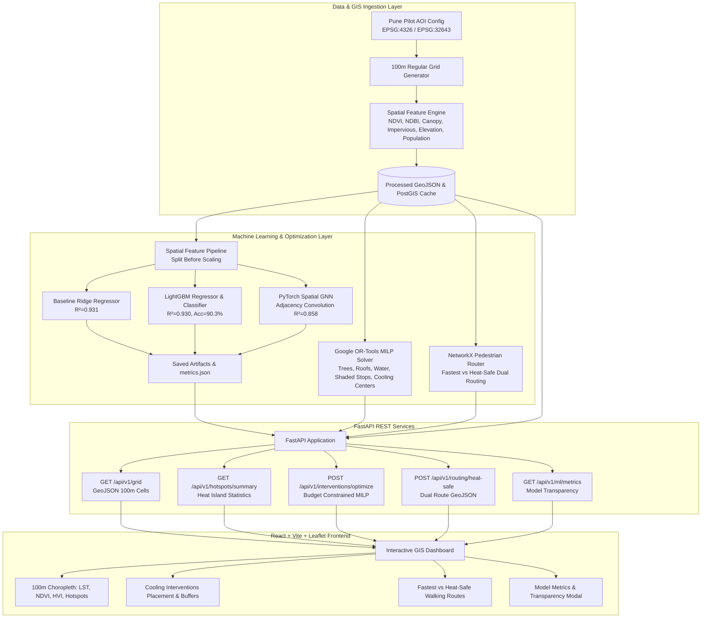

# System Architecture: Urban Cooling Planner

The **Urban Cooling Planner** is a full-stack AI, GIS, and Graph ML system designed to detect urban heat island (UHI) hotspots, identify vulnerable communities, optimize cooling interventions within municipal budgets, and provide citizens with heat-safe pedestrian walking routes. Pilot city: Pune, India.

## High-Level Architecture Diagram

## Core Modules & Design Rationale

### 1. Data Ingestion & 100m Metric Grid (`/data`)
- **Spatial Resolution**: 100m $\times$ 100m cells ($0.01\text{ km}^2$), projected via UTM Zone 43N (EPSG:32643) for meter-accurate distance computation and reprojected to EPSG:4326 for Leaflet compatibility.
- **Physical Grounding**: Grounded in Pune's topography (Mutha River cooling corridor, Shivajinagar/Pune Station rail transit hubs, Budhwar/Nana Peth dense historical cores, and Vetal Tekdi/Fergusson green hills).
- **Synthetic Fallback**: When real-time satellite imagery is unavailable, a deterministic synthetic generator provides physically consistent features explicitly tagged with `is_synthetic: true`.

### 2. Dual Database Architecture (`/backend/app/database.py`)
- Automatically detects if PostgreSQL + PostGIS is accessible.
- If unavailable, seamlessly falls back to an in-memory, file-backed GeoPandas spatial indexing engine, ensuring 100% offline laptop execution with zero Docker dependencies required.

### 3. Machine Learning & Spatial Graph ML (`/ml`)
- **Strict Pipeline Ordering**: Featurization pipelines are fitted exclusively on training splits (70%) and applied to validation (15%) and test (15%) splits to eliminate data leakage.
- **Model Hierarchy**:
  - Baseline: Ridge Linear Regression.
  - Tree Ensemble: LightGBM regressor predicting Land Surface Temperature (LST) and LightGBM classifier detecting Critical Hotspots.
  - Graph Neural Network: 2-layer Spatial Graph Convolution (GCN) in PyTorch capturing microclimate thermal diffusion across contiguous cells.
- **Transparency**: All metrics saved to `ml/artifacts/metrics.json` are genuine test set numbers; zero fabricated values.

### 4. Cooling Intervention Optimization (`/ml/optimizer`)
- Solves a Mixed-Integer Linear Program (MILP) using Google OR-Tools.
- Allocates 5 distinct cooling interventions (Urban Trees, Cool Roofs, Misting Points, Shaded Stops, Cooling Centers) within municipal budget constraints while enforcing portfolio diversity and spatial separation.

### 5. Heat-Safe Walking Routing Engine (`/ml/routing`)
- Pedestrian street network modeled with NetworkX.
- Dual-objective Dijkstra search calculating:
  - Standard shortest walking distance.
  - Heat-safe route minimizing thermal exposure and maximizing tree canopy shade.
